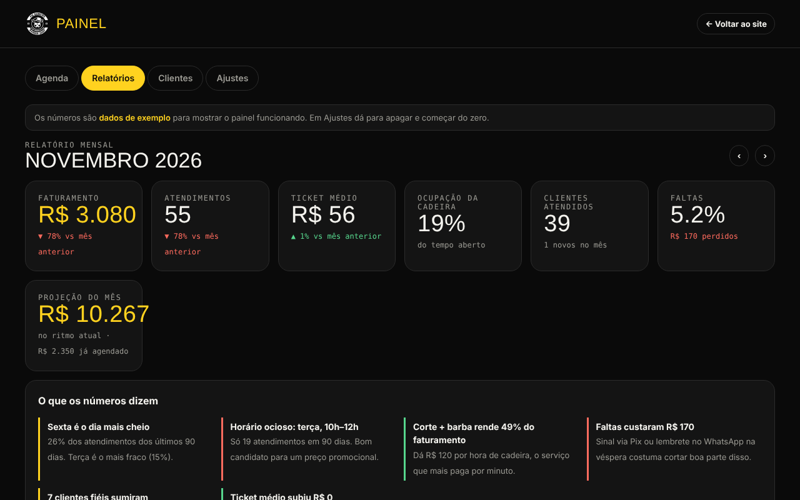

# Pig Barbeiro — agendamento e gestão para barbearia

Sistema de agendamento online com painel de gestão, feito para uma barbearia real em Santa Cruz do Rio Pardo (SP). O objetivo era substituir uma plataforma genérica de agendamento por algo com a identidade da casa e, principalmente, dar ao barbeiro números que ele não tinha: quanto fatura, quais dias enchem, quais clientes sumiram.

**[Ver o site no ar →](https://lukas140803.github.io/pig-barbeiro/)**

## Para o cliente

- Agendamento em três passos: serviço, dia e horário, confirmação
- Calcula os horários disponíveis a partir da duração de cada serviço, do expediente e da pausa de almoço
- Consulta pelo telefone: próximos horários, histórico e cancelamento
- Resumo do agendamento enviado direto para o WhatsApp do barbeiro

## Para o barbeiro (painel)

- **Agenda do dia** com status de cada horário (confirmação, lembrete, atendido, faltou) e registro de quem chega sem marcar
- **Relatório mensal**: faturamento, ticket médio, ocupação da cadeira, faltas e projeção de fechamento do mês
- **Leitura automática dos números**: dia mais cheio, horários ociosos que merecem promoção, serviço que mais rende por hora, quanto as faltas custaram
- **Base de clientes**: taxa de retorno, intervalo médio entre cortes e lista de clientes fiéis que passaram do prazo, com mensagem pronta para chamar no WhatsApp

> Os números do painel são dados de exemplo gerados pelo próprio sistema, para demonstrar o funcionamento. Nenhum dado de cliente real está neste repositório.

## Como foi feito

Um único arquivo HTML com CSS e JavaScript puros, sem frameworks nem servidor. Os dados ficam salvos no navegador (`localStorage`), o que permitiu validar a ideia com o barbeiro sem custo de infraestrutura. Publicado via GitHub Pages.

**Próximo passo:** levar agenda e clientes para um banco de dados na nuvem, para que cliente e barbeiro vejam os mesmos horários em qualquer aparelho, e proteger o painel com login.
